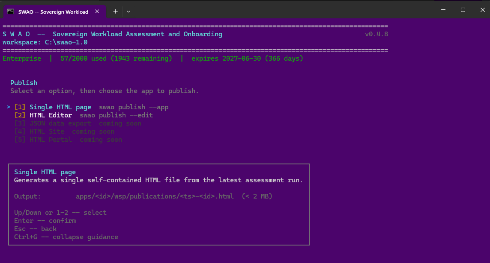

# 5. HTML veröffentlichen

Wählen Sie Option 5 im Hauptmenü (oder führen `swao publish` aus), um eine **eigenständige HTML-Datei** aus Ihren Bewertungsergebnissen zu erstellen. Die Datei funktioniert offline, in luftgespalteten Umgebungen und als E-Mail-Anhang: kein Server erforderlich.

## Was die Veröffentlichung enthält

| Ansicht | Zielgruppe | Inhalt |
|---|---|---|
| Führungsübersicht | Programmsponsor / CISO | 7R-Urteil, Abdeckungspunktzahl, wichtigste Risiken |
| Technische Erkenntnisse | Architekt / Entwickler | Alle Signale mit Begründung und Evidenzlinks |
| Compliance-Ansicht | DSB / Compliance-Beauftragter | Rahmenwerkspezifische Kontrolltabelle |
| Prüferansicht | Externer / interner Prüfer | Prüfprotokoll mit Zeitstempeln und Bewerteridentität |
| Evidenzgalerie | Prüfer | Screenshots und Artefakte aus der dynamischen Analyse |
| Laufprotokoll | Consultant | Dauer, LLM-Kosten, Durchlauf-Aufschlüsselung |

Die Veröffentlichung enthält einen Volltextsuchindex, der zur Generierungszeit erstellt wird: kein externer Suchdienst.


*Der Publish-Bildschirm in der Terminaloberfläche (Menüpunkt 5): eine eigenständige HTML-Seite oder der HTML-Editor (Enterprise). Aufgenommen mit einer früheren SWAO-Version.*

## Beispiel-Veröffentlichungen

Drei HTML-Veröffentlichungen für die Demo-Anwendung Sovereign Health, dargestellt aus dem öffentlichen Repository:

| Typ | Beschreibung | Link |
|---|---|---|
| Anwendungsbewertung | Vollständiger DSGVO- und BSI-C5-Compliance-Bericht für eine fiktive Patientenverwaltungsanwendung. Signalbefunde, Risikoregister und 7R-Migrationsstrategie, alle aus statischer und LLM-Analyse belegt. | [Live-Bericht öffnen](https://htmlpreview.github.io/?https://github.com/Accenture/SWAO/blob/main/examples/publications/2026-08-23T17-29-27-sovereign-health.html) |
| Landing-Zone-Bewertung | Fit/Gap-Analyse, die EU-souveräne Cloud-Anbieter und Hyperscaler für die Anwendung Sovereign Health vergleicht. Zeigt, welche Anbieter die Anforderungen an Datenresidenz und Compliance erfüllen. | [Live-Bericht öffnen](https://htmlpreview.github.io/?https://github.com/Accenture/SWAO/blob/main/examples/publications/2026-08-24T11-36-12-sovereign-health-lz.html) |
| LLM-Bewertung | Souveränitäts-Benchmark über mehrere LLMs. Bewertet Sprachmodelle anhand von Datenresidenz, DSGVO und BSI C5, mit Urteilen pro Modell und belegter Begründung. | [Live-Bericht öffnen](https://htmlpreview.github.io/?https://github.com/Accenture/SWAO/blob/main/examples/publications/2026-08-24-08-32-09-llm-assessment.html) |

## CLI

```bash
swao publish --app meine-app
# Ausgabe: wsp/publications/latest/index.html
```

## Engagement Hub

Der **Engagement Hub** des Workspace ist eine Portfolio-Ansicht über alle
bewerteten Anwendungen hinweg, veröffentlicht nach
`wsp/publications/engagement-hub.html`. Er bietet einem Einsatz einen zentralen
Einstiegspunkt mit:

- **Portfolio-Kennzahlen** je Bewertungstyp: Anwendungen, bewertet,
  Portfolio-Risiko, End-of-Life, Blocker und kritische Findings.
- **Kacheln je Anwendung** mit der 7R-Migrationsstrategie und ihrer Herkunft
  (bewertet, aus TIME abgeleitet oder durch Analyst), dem TIME-Quadranten, Risiko
  und Gesundheit, Abdeckung und End-of-Life-Status, jeweils verlinkt auf die
  Publikationen der Anwendung.
- **Diagramme** (nur CSS): TIME, 7R, End-of-Life, Risikoverteilung, Findings nach
  Schweregrad und Compliance je Framework.
- **Landing-Zone-Eignung** je Ziel sowie geschätzte monatliche Cloud-Kosten für
  Services.
- Eine **sortierbare, filterbare Tabelle**: Filtern zuerst nach Bewertungstyp,
  dann TIME, 7R, End-of-Life und Welle, plus eine Freitextsuche.

Der Hub wird nach jeder Veröffentlichung automatisch neu erstellt. Auf Abruf
neu erstellen mit `swao publish --portfolio` oder über den Eintrag
"Portfolio Engagement Hub (Enterprise)" im Publish-HTML-Bildschirm.

```bash
swao publish --portfolio
# Ausgabe: wsp/publications/engagement-hub.html
```

## Edition

<Badge type="tip" text="Consultant"/> <Badge type="warning" text="Enterprise"/>

Verfügbar in **Consultant** und **Enterprise** Editionen. Der HTML-Editor (`swao publish --edit`) und der Engagement Hub (`swao publish --portfolio`) sind nur in Enterprise enthalten.

Siehe auch: [Bericht erstellen](/de/generate-report) | [BI exportieren](/de/export-bi)
