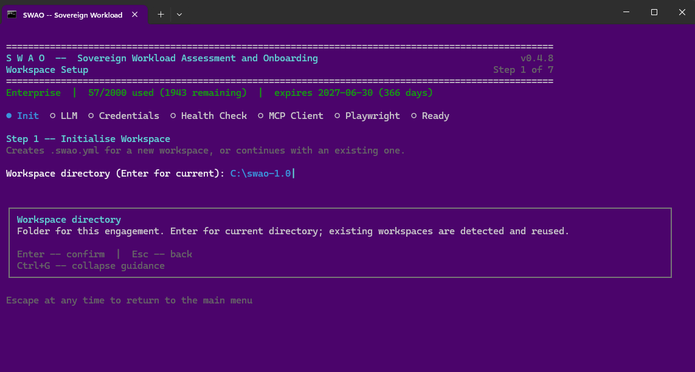

# 1. Workspace-Setup

Der **Workspace-Setup-Assistent** startet bei Auswahl von Option 1 im SWAO-Hauptmenü. Er hat zwei Teile: ein allgemeines Workspace-Setup, das jeder Workspace braucht, und je Bewertungsart ein kurzes eigenes Setup. Sie richten nur die Bewertungsarten ein, die Sie ausführen werden, jetzt oder später.

## Erster Start

1. **Workspace-Setup** (jeder Workspace).
2. **Welche Bewertungen werden Sie ausführen?** Wählen Sie eine oder mehrere der fünf Bewertungsarten.
3. **Ein Setup je gewählter Art**, in der Reihenfolge unten. Jedes endet mit einem Health Check, der nur diese Art abdeckt, und einer eigenen Zusammenfassung Fertig.

Die Schrittleiste zeigt die Schritte des aktuellen Teils. Während des Setups einer Bewertungsart erscheint der abgeschlossene Workspace-Teil als ein Eintrag **Workspace**, und der Untertitel nennt die Art, zum Beispiel *Setup: Landing Zone Live Assessment*.

## Workspace-Setup

| Schritt | Was er tut |
|---|---|
| Init | Engagement-Name, Kundenkürzel, verantwortliche Person und Verzeichnis; erstellt die Engagement-Ordnerstruktur und legt vier Demo-Rahmenwerke an |
| LLM | Primärer und optionaler zweiter LLM-Anbieter und Modell: Anthropic, OpenAI, Amazon Bedrock Gateway, Ollama und die weiteren Gateway-Konnektoren |
| Zugangsdaten | Speichert die LLM-Schlüssel im Credential-Vault und prüft die Verbindung |
| MCP Client | Registriert SWAO in Claude Desktop, Claude Code, Kilo, Cursor oder VS Code (Enterprise) |
| Health Check | Führt die allgemeinen Prüfungen aus: Lizenz, Engagement-Metadaten, Credential-Vault, LLM-Gateway, MCP und Community-Rahmenwerke |
| Bewertungen | Auswahl der Bewertungsarten; gespeichert als `workspace.assessment_types` in der Workspace-`.swao.yml` |

Bewertungsarten, die Ihre Lizenzstufe nicht ausführen kann, erscheinen ausgegraut mit der benötigten Stufe. Das Landing Zone Live Assessment braucht Consultant; die anderen vier laufen auf jeder Stufe.

## Setup je Bewertungsart

| Bewertungsart | Schritte | Der Health Check prüft |
|---|---|---|
| Application Assessment | App, Quellzugriff, Playwright-Browser, Testcode, Scanner und IaC-Werkzeuge | Voraussetzungen, IaC-Werkzeuge, Playwright, VCS-Zugriff, Importe, Ingestion, Scope, Rückverfolgbarkeit, BI-Export |
| Service Portfolio Assessment | Service-Workspace, Intake-Arbeitsmappen im Portfolio-Ingestion-Ordner, Bewertungsgrundlagen | Service-Workspace, Intake-Zuordnung, APM-Gewichte, Anbieterkatalog, Recherche-Cache, Clusterbildung, PII-Prüfprotokoll, Delta-Snapshot, Rahmenwerk-Controls |
| Landing Zone Catalog Assessment | Kataloge je Anbieter (mitgeliefert, im Workspace und selbst definiert), Ziele, Katalog-Aktualisierung | LZ-Katalogabdeckung, Community-Rahmenwerke |
| Landing Zone Live Assessment | Landing Zones und Scopes mit Zugangsdaten, Lese-Probe, Client LZ Policy Baseline, Organisationsnachweise | LZ-Verbindungen, Credential-Vault, Community-Rahmenwerke |
| LLM Assessment | Zwei bis fünf LLM-Konnektoren zum Vergleich, die bewertete App (braucht ein abgeschlossenes Application Assessment) | LLM-Gateway |

Jeder Health Check führt zusätzlich die allgemeinen Prüfungen aus. Eine Prüfung, die nicht zur Art gehört, wird weder ausgeführt noch aufgelistet. Die Zusammenfassung Fertig zeigt das Ergebnis (`ready` oder `needs attention`), die fehlgeschlagenen und gewarnten Prüfungen sowie, was eingerichtet ist oder fehlt. Der Zustand jeder Art wird als `workspace.setup_state` in der Workspace-`.swao.yml` gespeichert, damit das Setup-Menü ihn anzeigen kann.

## Später: eine weitere Art einrichten

Öffnen Sie Setup erneut im Hauptmenü. Ein bereits eingerichteter Workspace bietet:

- **Bewertungsart einrichten**: die fünf Arten mit ihrem Zustand (`not set up`, `ready`, `needs attention`); die Auswahl einer Art führt nur deren Setup aus;
- **Workspace-Setup**: den allgemeinen Teil erneut;
- **Vollständiges Setup**: den allgemeinen Teil, dann die Auswahl der Arten.

Jeder Schritt zeigt den aktuellen Wert; Enter behält ihn. Ein Setup kann jederzeit erneut ausgeführt werden.

Bestehende Workspaces: Beim ersten Start nach dem Update hält SWAO die Arten, die ein Workspace bereits nutzt (Apps mit Läufen, ein Block `service_portfolio`, `assessment.landing_zone.targets`, `landing_zones`, Läufe des LLM Assessment), in `workspace.assessment_types` fest. Sonst ändert sich nichts.

## Setup-Werte sind die Vorgaben der Bewertungen

Was ein Setup speichert, ist beim Ausführen der Bewertung vorausgewählt. Sie können es zur Laufzeit ändern; die Änderung wird nur gespeichert, wenn Sie sie als neue Vorgabe sichern.

| Bewertungsart | Gespeichert in `.swao.yml` | Vorausgewählt in |
|---|---|---|
| Application | `apps/<id>/.swao.yml`, `assessment.test_code.mode` | der App-Auswahl (eine einzelne App wird automatisch gewählt) |
| Service Portfolio | `service_portfolio.intake`, `service_portfolio.mapping` | der Intake-Auswahl |
| Landing Zone Catalog | `assessment.landing_zone.targets` | der Zielliste |
| Landing Zone Live | `landing_zones[]`, `landing_zones[].frameworks` | der Auswahl von Landing Zone, Scope und Rahmenwerken |
| LLM | `assessment.llm.candidates`, `assessment.llm.subject_app` | der Konnektorliste und der App-Auswahl |

Ältere Felder werden weiterhin gelesen: `service_portfolio.source` für den Intake sowie `llm_assessment.legs` und `llm_assessment.default_app` für die LLM-Konnektoren und die bewertete App.


*Der Workspace-Setup-Assistent bei Schritt 1 (Init). Aufgenommen mit einer früheren SWAO-Version.*

## CLI-Äquivalent

```bash
# Allgemeines Workspace-Setup
swao init mein-engagement --name app-crm-01
swao credential set anthropic-api-key <ihr-api-schluessel>

# Setup einer Bewertungsart im Assistenten öffnen
swao setup --type application

# Eine Bewertungsart ohne Assistent prüfen (Skripte, CI)
swao setup --type lz-live --non-interactive
swao setup --type service --non-interactive --json

# Health Check einer Bewertungsart
swao health-check --type llm
```

`--type` nimmt `application`, `service`, `lz-catalog`, `lz-live` oder `llm` (`swao health-check` zusätzlich `generic`). `swao setup --type <art> --non-interactive` führt den Health Check dieser Art aus, speichert ihren Zustand, gibt die fehlgeschlagenen und gewarnten Prüfungen und die fehlenden Punkte aus und endet mit Exit-Code 1, wenn die Art Aufmerksamkeit braucht. Ohne `--type` führt `swao health-check` wie bisher alle Prüfungen aus.

Landing-Zone-Katalogziele lassen sich auch je Lauf übergeben:

```bash
swao assess --app app-crm-01 --lz-cat-targets azure:europe,stackit:eu01
```

Eine App-`.swao.yml` und `--lz-cat-targets` haben Vorrang vor den Workspace-Zielen. Eine Geografie wird zur Laufzeit in ihre Standardregion aufgelöst; der Anwendungslauf hält angeforderte, aufgelöste und übersprungene Ziele in `run-status.json` fest, und ein übersprungenes Ziel kennzeichnet den Lauf als `partial`. Der Textbericht (`swao report`) zeigt sie unter **Landing Zone Catalogue Fit**.

Neue Workspaces enthalten vier Demo-Rahmenwerke. Weitere Community-Rahmenwerke kopieren Sie von
[GitHub](https://github.com/Accenture/SWAO/tree/main/community-frameworks) in den Workspace (`wsp/inputs/catalogs/community/<ordner>/`) und wählen sie je App beim Ausführen einer Bewertung.

## Testcode

Standardmäßig analysiert SWAO Testcode wie Produktivcode. Bei gemischten Codebasen lässt sich Testcode aus den Befunden heraushalten:

```yaml
assessment:
  exclude_test_code: true      # Kurzform; false (Standard) analysiert alles
  # oder die erweiterte Form:
  test_code:
    mode: tag                  # include (Standard) | tag | exclude
    extra_patterns: ["systemtest/**", "**/e2e/**"]
    keep_patterns: []
```

- `include`: Alles wird analysiert; die Ergebnisse bleiben unverändert.
- `tag`: Alles wird analysiert; Befunde, die nur auf Testcode beruhen, werden als `test_code` gekennzeichnet und um eine Schweregradstufe abgesenkt (der ursprüngliche Schweregrad bleibt erhalten).
- `exclude`: Testdateien werden nicht gelesen. Der Secret-Scan deckt sie weiterhin ab: Ein Passwort im Testcode bleibt ein Befund, gekennzeichnet als Testcode.

Testcode wird über eingebaute Regeln erkannt (`src/test/`, `test/`, `tests/`, `__tests__/`, `systemtest/`, `e2e/`, `mock/`, `*.test.ts`, `*.spec.js`, `*Test.java`, `*IT.java`, `*ITest.java`, ...) sowie über die Testordner, die in `pom.xml`, Gradle-Source-Sets und der vitest- / jest-Konfiguration deklariert sind. `keep_patterns` hat Vorrang vor allen Regeln. Eine App-`.swao.yml` hat Vorrang vor der Workspace-Einstellung. Der Abschnitt **Assessment Scope** der Publikation zeigt den Modus, die Zahl der Testdateien und die gekennzeichneten Befunde.

## Nach dem Setup

Führen Sie jederzeit einen [Health Check](/de/health-check) aus; `swao health-check --type <art>` prüft eine Bewertungsart.

Siehe auch: [Wie SWAO funktioniert](/de/how-it-works)
