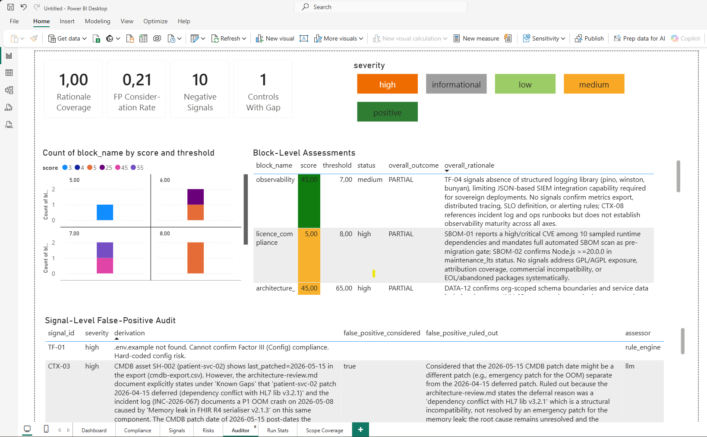
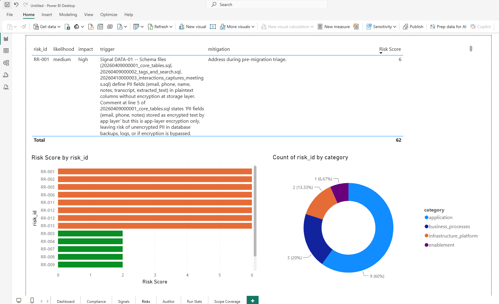

# 6. Export BI

Select option 6 from the main menu (or run `swao export`) to generate a structured data export bundle for use in Power BI, Tableau, Excel, or any other BI tool.

## Export formats

| Format | Contents | Use case |
|---|---|---|
| CSV (star schema) | 17 fact and dimension tables | Power BI Desktop, Tableau, Excel |
| NDJSON | Newline-delimited JSON mirror of the CSV tables | Data pipelines, dbt, custom tooling |
| XLSX | Single-workbook rollup | Quick review, stakeholder sharing |

The star schema export is available in every edition, including Community <Badge type="info" text="Community"/>.

## Pre-built Power BI templates

On Consultant and Enterprise, two `.pbit` templates are included in your workspace under `wsp/templates/powerbi/` <Badge type="tip" text="Consultant"/>. On Community, `swao export` writes the star schema and a licence notice instead of the templates.

| Template | Edition | Pages |
|---|---|---|
| `swao-report.pbit` | Consultant and Enterprise | Overview, Compliance, Signals, Risks, Auditor, Run Stats |
| `swao-portfolio.pbit` | Consultant and Enterprise (portfolio data needs Enterprise) | Portfolio overview, heatmap, compliance, risk and 7R, wave sequencing |

Open the `.pbit` file in Power BI Desktop, set `SWAOExportPath` to your `star/` folder, and click **Load**.


*The Auditor page of `swao-report.pbit` for the Sovereign Health demo application: every signal carries its rationale and assessor.*


*The Risks page of `swao-report.pbit`: risk register with likelihood, impact and mitigation, ranked by score.*

## Portfolio export (application and service apps)

`swao service export` <Badge type="warning" text="Enterprise"/> writes the portfolio star schema (`wsp/star-schema/portfolio-*.json`, 9 tables) and the portfolio workbook (`wsp/reports/swao-portfolio-YYYYMMDD.xlsx`, 14 sheets) from `wsp/portfolio-summary.json`. Since the combined portfolio view ([Portfolio Operations](/portfolio)) both hold application and service apps:

- `dim_service_app.assessment_type` is `application` or `service`; join the other portfolio tables on `app_id` to filter by type.
- The workbook sheets Portfolio Overview, Migration Waves, Migration Candidates and Cost vs Risk end with an `Assessment Type` column; Source Data has `computed.assessment_type` (and `computed.seven_r_label` when an application app is present).

A service-only workspace produces the same tables and sheets as before, apart from the new column. The `.pbit` templates above read the application export (`swao export`) and are unchanged; a Power BI model over the portfolio tables filters on `dim_service_app.assessment_type`.

## CLI

```bash
swao export --app my-app --formats csv,ndjson,xlsx
```

See also: [Publish HTML](/publish-html)
