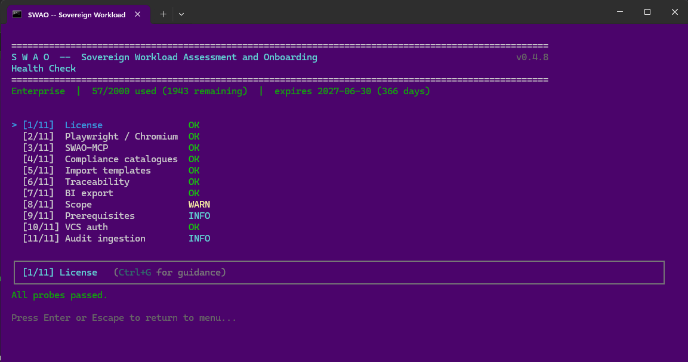

# 2. Health Check

Run `swao health-check` (or select option 2 from the main menu) to verify that your workspace is ready for an assessment. It runs 25 probes; probes 17 to 25 apply to Service Portfolio workspaces and show INFO elsewhere. Resolve every FAIL before an assessment; WARN and INFO are advisory.

## Checks

| Check | What it verifies |
|---|---|
| Licence | Edition detected and valid |
| Playwright | Browser engine ready for dynamic analysis |
| MCP | Model Context Protocol server configuration. Checks every Claude Desktop config (Microsoft Store / MSIX and classic installation) and warns when any SWAO entry points at a binary that no longer exists or is not the running SWAO binary; each stale entry is listed with its config path |
| Compliance catalogues | Framework YAML files present and parseable |
| Import templates | Context ingestion folder structure in place |
| Traceability | Audit-grade signal fields enabled |
| BI export bundle | Integrity of the last export (skipped on first run) |
| LZ catalogue (probe 15) | Every LZ catalogue the fit can resolve loads and validates, the catalogue quality rules below pass for the bundled catalogues (and for a workspace catalogue folder that holds catalogue files), and the LZ targets configured in `.swao.yml` name a known provider and region or geography. Any error or warning finding is a WARN; the probe never fails |

## LZ catalogue quality rules

The SWAO team owns the bundled LZ catalogues (`lz-catalogues/`: one JSON file per provider, `_lz-catalogue-template.json`, `_coming-soon.json`, `aws-service-meta.json`, and the VM price table `prices/vm-prices.json` of the service cost model). There is no `index.json`: SWAO lists the catalogues from each file's own `meta` block, so the rules check each file on its own; an `index.json` left in an older workspace folder is ignored. Probe 15 and the CI audit gate `tests/audit-gates/lz-catalogue-quality.gate.mjs` apply the same rules (`module-landing-zone/src/catalogue/quality.ts`). Error rules fail the gate, so an inconsistent catalogue cannot ship; warning rules are reported only. In the health check an error or warning finding makes probe 15 WARN, an info finding (`target-geography`) does not; none fails the health check.

| Rule | Severity | What it checks |
|---|---|---|
| `template-invalid` | error | `_lz-catalogue-template.json` exists and, without its `_comment` keys, passes the catalogue schema |
| `catalogue-schema` | error | The catalogue folder is readable, and every catalogue file is valid JSON and passes the catalogue schema; a failure names the file and the reason and is never skipped |
| `provider-filename` | error | `meta.provider` matches the file name |
| `meta-fields` | error | The `meta` block has exactly the field set of the template |
| `regions-count` | error | `meta.regions_count` equals the number of regions |
| `region-id-duplicate` | error | Region ids are unique within a provider |
| `sovereignty-shape` | error | Every region carries `residency_country`, `operator_jurisdiction`, `extraterritorial_exposure` and `certifications`; a region whose site the customer chooses states `residency_country: OPERATOR_SITE`, which is valid only with `operator_jurisdiction: operator-site` |
| `confidence-vocabulary` | error | `meta.confidence` is `high`, `medium` or `low` |
| `certification-vocabulary` | warning | Every region certification is in the template vocabulary: `BSI_C5`, `ISO_27001`, `SOC_2`, `TISAX_L3`, `PCI_DSS`, `FedRAMP_High`, `MAS_TRM`, `IRAP` |
| `source-missing` | error | Every catalogue names a source (`meta.source.mode`) |
| `date-format` | error | `meta.last_updated` is a valid `YYYY-MM-DD` date |
| `stale` | warning | `last_updated` (or `generated_at` of `aws-service-meta.json`, or `meta.generated_at` of `prices/vm-prices.json`) is older than 90 days (`LZ_CATALOGUE_MAX_AGE_DAYS`) |
| `services-empty` | warning | A region lists no services |
| `service-code-duplicate` | warning | A service code appears twice in one region |
| `pin-drift` | warning | Sovereignty facts differ from the refresh overlay pin for that region (`catalogue/sovereignty-pins.ts`, the pins `swao lz catalogue update` writes) |
| `facts-unsourced` | warning | Sovereignty facts carry no source: the `UNKNOWN` residency placeholder, or no overlay pin and no `meta.source.source_note` |
| `geography-coverage` | error | Every region with a residency country is tagged by the shared geography model; a residency country outside the model fails, as does a catalogue with no tagged region unless all its regions are operator-site regions (`OPERATOR_SITE`) |
| `price-table` | error | The VM price table `prices/vm-prices.json`, when present, is valid JSON and passes the price table schema: every price names provider, size, OS (`linux` or `windows`), region, currency and a positive hourly price, and every provider region has a source with API, URL and retrieval date |
| `target-invalid` | warning (health check only) | A target in the workspace or app `.swao.yml` (`assessment.landing_zone.provider` + `region`, or `assessment.landing_zone.targets`) names an unknown provider or region; the warning lists valid region ids |
| `target-geography` | info (health check only) | A target names a known geography (for example `azure:Europe`) instead of a region id; it is not a warning, and the line names the default region it resolves to (see [Landing Zone Catalog Assessment](/assessment/landing-zone#geographies)) |

`swao health-check --json` carries every finding under `lz_catalogue_coverage.quality` (rule, severity, file, provider, region, message) with the error and warning counts; the text output groups region findings per rule and file. Run the gate locally with `node tests/audit-gates/lz-catalogue-quality.gate.mjs` (Node with TypeScript type stripping, 22.18 or later).

The age threshold stays at 90 days; the release runbook refreshes the bundled catalogues before every minor release, so shipped catalogues are not stale. Residency pins added from provider region pages carry their source URL and retrieval date in `LZ_SOVEREIGNTY_PIN_SOURCES` (`catalogue/sovereignty-pins.ts`).

## Run status

Every assessment run (application, service and landing zone catalogue) writes `run-status.json` into its run folder `apps/<id>/wsp/runs/<timestamp>/`. The status is `started` when the run begins and is closed on every exit path:

| Status | Meaning |
|---|---|
| `started` | The run is in progress, or the process was killed or crashed before it could close the run |
| `complete` | The run finished normally |
| `partial` | The run finished, but some landing zone targets were skipped (`failed_targets`) or some passes failed (`failed_passes`) |
| `failed` | The run stopped before completion, for example a `--fail-on` gate exit or an error; `exit_code` and `reason` say why, and no `run-manifest.json` is written |
| `aborted` | The run was interrupted (SIGINT or SIGTERM) |

The health check lists runs among the latest 10 per app that are `failed` or `aborted`, or still `started` more than 6 hours after they began (stale), for example `[WARN] apps/billing/wsp/runs/2026-10-17T09-00-00: application run failed (exit 6): --fail-on severity=high: 3 signal(s) matched`. The publication run history, the engagement hub, the MCP run listing, the Power BI export and run retention (`workspace.run_retention.keep_latest`, which counts only completed runs) use only `complete` and `partial` runs, and the engagement hub flags an app whose newest run did not complete. Runs from before this marker existed are treated as before: a run counts as completed when it has a `run-manifest.json`.


*The Health Check screen in the terminal interface (menu option 2). Captured with an earlier SWAO version that ran 11 probes; select a probe to read its guidance text.*

## Interpreting results

- **Green**: check passed; no action needed.
- **Yellow / warning**: advisory; assessment can proceed but a non-critical component is missing.
- **Red / blocker**: assessment will fail or produce incomplete output until resolved. The check output includes a remediation hint.

Only FAIL results count as failures. The summary line (`All probes passed.` or `N probe(s) failed: ...`) names the failed probes, and the Setup Wizard reports the same failure count, with warnings listed separately.

## CLI

```bash
swao health-check
swao health-check --verbose
```

See also: [Workspace Setup](/workspace-setup) | [Troubleshooting runbook](/runbooks/troubleshooting)
