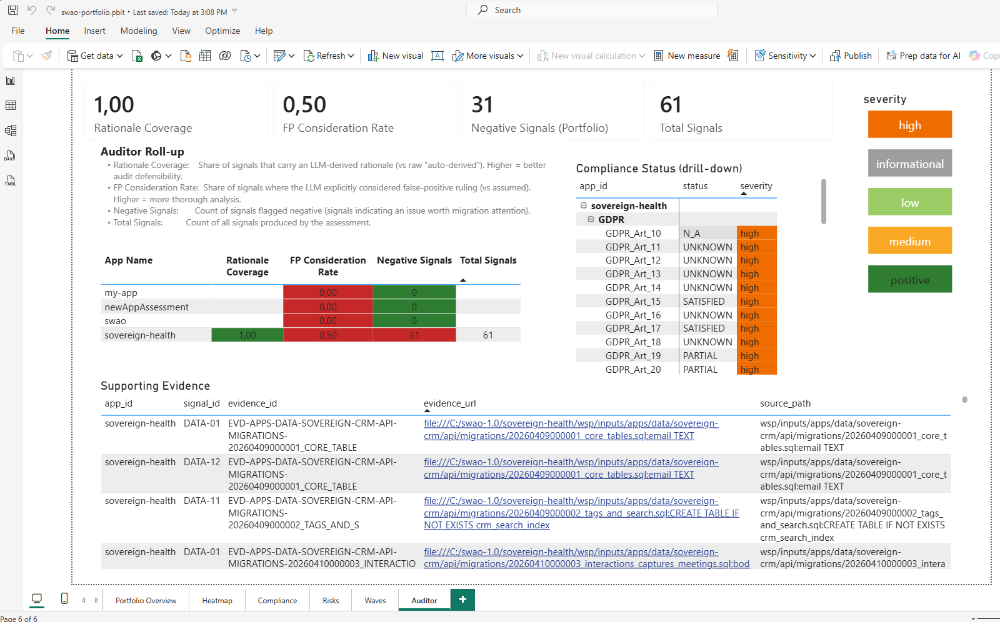

# 7. Portfolio Operations

Portfolio Operations (option 7 in the main menu) aggregate assessment results across multiple applications in a single workspace. Available in the **Enterprise** edition <Badge type="warning" text="Enterprise"/>.

## What portfolio mode provides

| Capability | Description |
|---|---|
| Multi-app assessment | Run assessments across all apps in a workspace in sequence or in parallel |
| Aggregated risk register | Cross-application finding list, deduplicated and ranked |
| Portfolio compliance matrix | Framework coverage across every assessed app |
| Migration wave planning | Dependency-aware sequencing for phased cloud migration |
| Portfolio Power BI dashboard | `swao-portfolio.pbit` with heatmap and wave views (portfolio data: Enterprise) |


*The Auditor roll-up of `swao-portfolio.pbit` for a demo workspace with four apps: coverage per app, per-control status and the supporting evidence side by side.*

## CLI

```bash
# Assess all apps in the workspace
swao assess --portfolio

# Export aggregated BI bundle
swao export --portfolio --formats csv,xlsx

# Open the portfolio dashboard
# Open wsp/templates/powerbi/swao-portfolio.pbit in Power BI Desktop
```

## Combined portfolio view (application and service apps)

One engagement workspace can hold application assessments (`swao assess --app <id>`) and Service Portfolio Assessment apps (`swao service init`) side by side. `wsp/portfolio-summary.json` is the combined view over both: every app is listed once with `assessment_type: application` or `assessment_type: service`.

| | Application apps | Service apps |
|---|---|---|
| Evidence | Latest usable application run (7R verdict, Pass 01 / 05 runtime end of life and dependency CVE lookup, negative critical and high findings, compliance outcomes, landing zone verdict) | Intake, research stubs, latest service run |
| TIME | From the 7R verdict (Retire: Eliminate; Retain: Tolerate; Rehost, Relocate, Replatform, Repurchase: Migrate; Refactor: Invest), see [SWAO_APM framework](/service-assessment/framework#application-apps-in-the-combined-view) | SWAO_APM TIME rules |
| Not assessed | No usable application run | No service assessment run |

Both types share one TIME distribution, one ranked list, one migration wave plan, one integration graph and one vendor consolidation. The headline figures cover assessed apps of both types; `by_assessment_type` in the summary gives the same figures per type. The summary is rebuilt by `swao service research`, a service assessment and `swao service export`; run one of them after new application assessments.

Where the type shows:

- MCP: `swao_service_portfolio` (filter `assessment_type`), `swao_service_app`, `swao_service_waves` and `swao_service_vendors` return both types with the `assessment_type` field.
- Enterprise workbook and star schema (`swao service export`): an `Assessment Type` column and `dim_service_app.assessment_type`, see [Export BI](/export-bi).
- Migration wave report (`wsp/reports/migration-waves-*.md` / `.csv`) and the engagement hub portfolio blocks: application apps carry a type column or an **Application** mark.

## Edition

Portfolio operations require **Enterprise**. The Community and Consultant editions can run individual assessments in the same workspace folder but do not aggregate results. The per-app star schema (`swao export`) is available in every edition.

See also: [Export BI](/export-bi) | [Features & Editions](/features)
