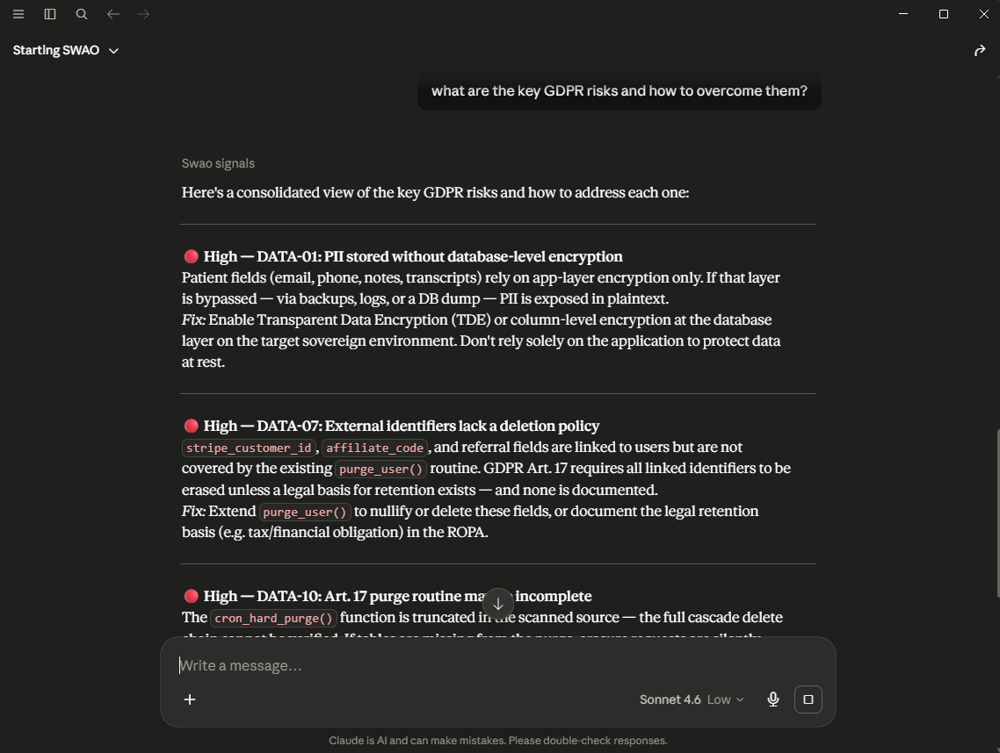

<!--
// =======================================================================
//
//                          S  W  A  O
//
//     Sovereign Workload Assessment and Onboarding
//     MCP Integration
//
//     Community Edition  -  Apache 2.0
//
//     Website       :  https://steady-echo-yp4z.here.now/
//     Technical Docs:  https://accenture.github.io/SWAO/en/
//     Source Code   :  https://github.com/Accenture/SWAO
//
// =======================================================================
-->

# SWAO MCP Server Integration Runbook

## Abstract


<Badge type="warning" text="Enterprise"/> The SWAO MCP server is part of the Enterprise edition.

SWAO exposes its assessment capabilities over the Model Context Protocol (MCP)
STDIO transport. Once registered, any MCP-compatible client (Claude Desktop,
Cursor, VS Code with an MCP extension, etc.) can invoke `swao_assess`,
`swao_report`, `swao_health_check`, and `swao_challenge` as native tools, and use
the `swao` entry point to show the workflow overview screen.

This runbook covers two installation modes (binary and source), per-platform
client configuration, verification, and troubleshooting.

For the short path (one install command per client, profiles, small local models and client pitfalls),
see [Using SWAO from an AI client](./mcp-ai-clients.md).

---

## 1. Installation modes

There are two ways to run the SWAO MCP server. Choose based on whether you
have the repository cloned and Node.js installed, or only the distributed
binary files.

| Mode | What you have | Node.js required |
|---|---|---|
| **Binary** | `swao-enterprise-win-x64.exe` / `swao-macos` / `swao-linux` from `dist-bin/` | No |
| **Source** | SWAO repository cloned, `dist/` built | Yes (20.x) |

Both modes start the server with the same `mcp` subcommand. The only
difference in the client configuration is the `command` field: the binary path
directly (binary mode) vs. `node` pointing at `dist/index.js` (source mode).

---

## 2. Binary mode: placing the files

The binary distribution ships three executables.
All files are found in `dist-bin/` of the SWAO repository, or delivered as a
release archive.

| File | Platform | Purpose |
|---|---|---|
| `swao-enterprise-win-x64.exe` | Windows | Self-contained CLI and MCP server |
| `swao-macos` | macOS | Self-contained CLI and MCP server |
| `swao-linux` | Linux | Self-contained CLI and MCP server |

### 2.1 Windows

1. Create a permanent folder for the binary, for example `C:\tools\swao\`.
   Avoid `Downloads` or any folder that may be cleared.
2. Copy `swao-enterprise-win-x64.exe` into that folder.
3. Optionally add `C:\tools\swao\` to your `PATH` so you can run `swao` from
   any terminal. This is not required for MCP.

Verify the binary works before registering it with any client:

```
C:\tools\swao\swao-enterprise-win-x64.exe mcp --help
```

Expected first line:

```
Start the SWAO MCP server (stdio transport). ...
```

### 2.2 macOS

1. Copy `swao-macos` to a permanent location, for example `/usr/local/bin/swao`
   or `~/bin/swao`.
2. Mark it executable:

```bash
chmod +x /usr/local/bin/swao
```

3. Verify:

```bash
/usr/local/bin/swao mcp --help
```

### 2.3 Linux

Same steps as macOS. Recommended location: `/usr/local/bin/swao` or `~/bin/swao`.

---

## 3. Source mode: building the dist

Skip this section if you are using the binary.

### 3.1 Requirements

- Node.js 20.x (`node --version` to check)
- SWAO repository cloned

### 3.2 Build

```bash
cd packages/swao
npx tsc --project tsconfig.json
```

No output means the build is clean. The server entry point is at
`packages/swao/dist/index.js`.

### 3.3 Verify

```bash
node packages/swao/dist/index.js mcp --help
```

Expected first line:

```
Start the SWAO MCP server (stdio transport). ...
```

---

## 4. How the MCP server works

The client launches the SWAO process as a subprocess over standard I/O. The
client and server exchange a JSON-RPC handshake, after which the client may
call tools on demand. The server process stays alive for the duration of the
client session.

The core workflow tools are listed below; the full list depends on the profile (section 4.3, `full` lists 53
tools) and `swao mcp profiles` prints it:

| Tool | Purpose |
|---|---|
| `swao` | Welcome screen: workflow overview, tool list, quick-start guide. Use this as the entry point. |
| `swao_assess` | Run a sovereignty assessment for one application (source scan, SBOM, egress, TF, crypto, LZR). |
| `swao_report` | Generate a report from an existing assessment. Supports role views: exec, compliance, finops, migration-manager, lzr. |
| `swao_health_check` | Health check: LLM connectivity, credential store, workspace layout, Playwright availability, licence status. |
| `swao_challenge` | Run a stakeholder challenge session against a WSP. Five agent perspectives available. |

The `swao_assess` and `swao_report` tools require two key parameters:

- `app_id`: the application folder name under `portfolio/apps/`
- `workspace_path`: absolute path to the portfolio root that contains `.swao.yml` (optional; not offered when
  the server workspace is pinned, section 4.2)

### 4.1 Service Portfolio Assessment tools

For a workspace scaffolded with `swao service init` (Design 103), the server
exposes the service results directly. Read tools follow
`FEATURE_GATES['service-assessment']` (Community, so no gate beyond the MCP
server's own licence; `swao_service_export` additionally requires Enterprise),
return JSON, accept `workspace_path` (unless pinned),
and cap long lists (`limit` / `offset`). Contact, phone and e-mail from the
intake are reported as presence booleans only; intake note text and analyst
text in research stubs are never returned. Failed, aborted and in-progress runs
(`run-status.json`) are listed but never read.

| Tool | Purpose |
|---|---|
| `swao_service_portfolio` | One row per application or service app from `wsp/portfolio-summary.json` (combined portfolio view): `assessment_type`, 7R verdict of application apps, TIME quadrant and reason, risk, health, evidence, assessed, wave, blast radius, end-of-life signal and date, CVE counts, KEV, site, cost. Filters: `assessment_type`, `time_quadrant`, `wave`, `site`, `infra_category`, `operational_status`, `evidence`, `assessed`, `eol_signal`, `eol_within_months`, `min_risk`, `kev_match`; `sort_by` risk, eol_date, fan_in or wave. |
| `swao_service_app` | Everything about one service app: intake fields, classification, cluster, cost estimate, integrations, TIME and domain scores, per-control SWAO_APM scores (`apm-score.json`), latest usable run and run history, scope coverage with skipped passes, research and binary summary. For an application app of the combined portfolio view: its portfolio row and integrations. |
| `swao_service_research` | Research stubs of one app, optionally one `topic`: CVE ids (capped), KEV, BSI, OSV, end of life, VirusTotal, and the LLM topics (vendor-profile, certifications, data-residency, breach-history) with status, skipped reason, confidence capped at medium, and sources marked as cited by the model and not verified by SWAO. |
| `swao_service_waves` | Migration waves (label, horizon, apps, effort days) and integration hubs (fan-in, blast radius) of both app types; every wave member and hub carries `assessment_type`, `evidence` and `not_assessed`. |
| `swao_service_vendors` | Vendor consolidation groups with opportunity score and tier. |
| `swao_service_delta` | Latest delta report against the previous snapshot: new, removed and changed apps, TIME and risk changes. |
| `swao_service_scaffold` | Scaffold summary: rows read, apps, clusters, SCAFFOLD signal counts, unclassified apps, recognised columns, PII column letters. |
| `swao_service_runs` | Service runs per app with their `run-status.json` status and the latest usable run. |
| `swao_service_init` | Runs `swao service init` (`from`, `mapping`, `refresh`). Writes to the workspace. |
| `swao_service_research_run` | Runs `swao service research` for all apps, one app (`app_id`) or a list (`apps`); `refresh`, `dry_run`. Writes to the workspace. Each CLI call stops after 5 minutes; an incomplete run is flagged `[incomplete]`. |
| `swao_service_export` | Enterprise: runs `swao service export` (portfolio workbook and star schema). |

`swao_assess` accepts `assessment_type: service`; `swao_publish` publishes a
service app with the service blocks; `swao_signals` and `swao_signal_detail`
include the RESEARCH, BINARY and SCAFFOLD signals of a service app;
`swao_portfolio_summary` and `swao_portfolio_stats` add a service section that
points to `swao_service_portfolio`.

Example questions:

- "Which apps reach end of life within 12 months?" (calls
  `swao_service_portfolio` with `eol_within_months: 12`, `sort_by: eol_date`)
- "Show the wave 1 apps" (calls `swao_service_waves` with `wave: 1`)
- "What does SWAO know about `<app>`?" (calls `swao_service_app`, then
  `swao_service_research` for detail)

### 4.2 Workspace resolution

Every tool, prompt, completion and resource resolves the workspace in this order
(Design 116 REQ-02):

1. `swao mcp --workspace <path>`
2. the environment variable `SWAO_WORKSPACE` (same meaning as the flag)
3. the workspace found from the server's working directory
4. the default workspace saved by `swao setup`

A workspace from the flag or the environment variable is *pinned*. On a pinned
server, `tools/list` does not offer the `workspace_path` parameter, and a call
that still passes one must name the pinned folder; any other value (also `/`)
fails with `isError`. Without a pin, `workspace_path` stays optional: leave it
empty to use the server's workspace. Since the release after 1.4.2, `--workspace`
beats the working directory (before, a server started inside one workspace
ignored `--workspace` for another).

For small local models, start the server pinned: the tool list is about 2,000
tokens shorter and the model cannot guess a wrong path.

### 4.3 Tool profiles

Every MCP client sends the full tool list with every model request. Small local models (8k to 32k
context) need a smaller list, so the server offers profiles (Design 116 REQ-08):

| Profile | Tools | For |
|---|---|---|
| `starter` | `swao`, `swao_health_check`, `swao_workspace_inventory`, `swao_frameworks_list`, `swao_passes` | First contact, demos, 8k to 16k local models |
| `assess` | `starter` plus `swao_assess`, `swao_report`, `swao_signals`, `swao_signal_detail`, `swao_control_detail`, `swao_risks`, `swao_publish`, `swao_explain_landing_zone`, `swao_costs` | Single-app assessment on 16k to 32k local models |
| `full` (default) | every listed tool | Hosted models, portfolio and service work |

Select a profile with `swao mcp --profile <name>`, or list exact tools with
`swao mcp --tools swao,swao_health_check` (not both). Without a flag the server reads
`SWAO_MCP_PROFILE` / `SWAO_MCP_TOOLS`, then the workspace `.swao.yml` `mcp:` block, then uses `full`.
An unknown profile or tool name stops the server with exit code 2 and the list of valid values.
`swao mcp profiles` prints each profile with its tools, measured size and token budget.

A tool outside the profile is not listed and a call to it fails with `isError`. The `starter` profile
offers the three static resources but no resource templates; the `swao_evidence_interview` prompt is
offered only where `swao_evidence_capture` is enabled. SWAO Chat always starts the server with
`--profile full`.

### 4.4 The start prompt

The server offers an MCP prompt `start` (title "Start SWAO") in every profile. It returns the SWAO main
menu with one sentence per entry, the typical first run and the questions you can ask next (only for
tools in the active profile), and tells the model to reply with it as written, without calling a tool.
Clients show prompts as slash commands: Claude Code `/mcp__swao__start` (or `/mcp__SWAO__start` when the
server is registered as `SWAO`), Kilo `/swao:start`; other clients list it in their prompt menu.

---

## 5. Client configuration

Each section below shows both the binary and source variants. Use whichever
matches your installation mode.

### 5.1 Claude Desktop, Windows (Store installation)

Config file path:

```
%LOCALAPPDATA%\Packages\Claude_pzs8sxrjxfjjc\LocalCache\Roaming\Claude\claude_desktop_config.json
```

**Binary variant** (replace path with wherever you placed `swao-enterprise-win-x64.exe`):

```json
{
  "mcpServers": {
    "SWAO": {
      "command": "C:\\tools\\swao\\swao-enterprise-win-x64.exe",
      "args": ["mcp"]
    }
  }
}
```

**Source variant** (replace `<repo-root>` with the absolute path to the cloned
repository, e.g. `C:\src\swao`):

```json
{
  "mcpServers": {
    "SWAO": {
      "command": "C:\\Program Files\\nodejs\\node.exe",
      "args": [
        "<repo-root>\\packages\\swao\\dist\\index.js",
        "mcp"
      ]
    }
  }
}
```

If the config already contains a `preferences` block, add `mcpServers` as a
sibling key:

```json
{
  "preferences": { ... },
  "mcpServers": {
    "SWAO": { ... }
  }
}
```

Quit Claude Desktop fully via the system tray icon (Quit, not just close the
window) and reopen it.

### 5.2 Claude Desktop, Windows (direct .exe installation)

Config file path:

```
%APPDATA%\Claude\claude_desktop_config.json
```

The JSON block is identical to Section 5.1. The only difference is the file
location.

**Both installations on one machine.** A machine that has had both a Store
(MSIX) and a direct .exe installation has both config files. Claude Desktop
reads the Store path when it exists. The Setup Wizard (MCP Client step),
`swao init --mcp` and `swao mcp install` update the config Claude Desktop
reads plus every other config that already holds a SWAO entry, and list each
file with its result. A config without a SWAO entry is not created or
changed. All three register the same entry: for a SWAO release binary, a
stable copy in the binary's folder named for the running binary's own tier
(`swao-<tier>-<os>-<arch>[.exe]`, so `swao-enterprise-win-x64.exe` for the
Enterprise Windows binary; a binary of one tier never overwrites another
tier's binary) with `args` `["mcp"]`; for a source run, the
absolute path to `node` with the script path and `mcp` as `args` (the
source variant above), and no copy is made. Registration is Enterprise
only: the Community and Consultant binaries, or a lower licence, get the
`[LICENSE]` message (exit 1) and nothing is copied or written. `swao health-check` (probe 3, SWAO-MCP) warns when any SWAO entry,
in either file, points at a binary that no longer exists or is not the
running SWAO binary.

### 5.3 Claude Desktop, macOS

Config file path:

```
~/Library/Application Support/Claude/claude_desktop_config.json
```

**Binary variant:**

```json
{
  "mcpServers": {
    "SWAO": {
      "command": "/usr/local/bin/swao",
      "args": ["mcp"]
    }
  }
}
```

**Source variant** (find the correct Node path with `which node`; common
locations: `/usr/local/bin/node` for Homebrew Intel,
`/opt/homebrew/bin/node` for Apple Silicon, `~/.nvm/versions/node/<v>/bin/node`
for nvm):

```json
{
  "mcpServers": {
    "SWAO": {
      "command": "/usr/local/bin/node",
      "args": [
        "/path/to/swao/packages/swao/dist/index.js",
        "mcp"
      ]
    }
  }
}
```

Use the full absolute path to `node`. The app's PATH differs from the shell's.

### 5.4 Cursor

Cursor reads MCP configuration from `.cursor/mcp.json` in the project root
or from `~/.cursor/mcp.json` globally.

**Binary variant:**

```json
{
  "mcpServers": {
    "SWAO": {
      "command": "/usr/local/bin/swao",
      "args": ["mcp"]
    }
  }
}
```

**Source variant:**

```json
{
  "mcpServers": {
    "SWAO": {
      "command": "node",
      "args": [
        "/path/to/swao/packages/swao/dist/index.js",
        "mcp"
      ]
    }
  }
}
```

Reload the Cursor window after saving.

### 5.5 VS Code with an MCP extension

Place the configuration in `.vscode/mcp.json` in the workspace root or in the
global user settings under `mcp.servers`, depending on the extension. The
command and args format is identical to the examples above.

### 5.6 Other MCP-compatible clients

Any client that supports STDIO transport can run SWAO. The invariant is:

- **Binary mode:** `command` is the absolute path to `swao-enterprise-win-x64.exe` / `swao-macos` / `swao-linux`; `args` is `["mcp"]`
- **Source mode:** `command` is the absolute path to `node`; `args` is `["<absolute-path>/dist/index.js", "mcp"]`
- **Transport:** stdio (not SSE or HTTP)

The server name key (`"SWAO"`) is a display label only; choose whatever
appears clearly in the client UI.

### 5.7 HTTP transport (`swao mcp --http`)

Claude Code in the Accenture-managed environment accepts only
`http://localhost*` servers (ADR-0045), and SWAO Chat uses the same transport.
Start the server before the client:

```
swao mcp --http [--port 3737] [--host localhost] [--allow-remote] [--workspace <path>] [--replace]
```

**Bind address (Design 116 REQ-03.1 to REQ-03.3, #3468).** The default
`--host localhost` listens on `127.0.0.1` and `::1` on the same port, so
`http://localhost:3737/mcp` works whether the client resolves `localhost` to
IPv4 or IPv6. When `::1` is unavailable the server warns and serves on IPv4.
The banner names the addresses actually bound, for example
`http://localhost:3737/mcp (127.0.0.1, ::1)`. Another loopback address
(`--host 127.0.0.1`, `--host ::1`) binds only itself. A non-loopback address
(`0.0.0.0`, `::`, a LAN address or host name) exits with code 2 unless
`--allow-remote` is given; with it the server prints a warning, because it has
no authentication. Use that only on a trusted network, for example for a
containerised client.

**Port handling (Design 116 REQ-03.4 to REQ-03.6, #3461).** The server never
stops another process to free its port:

- Port free: the server starts and records its PID in `swao-mcp-<port>.pid`
  in the system temp folder.
- Port held by another SWAO MCP server: exit code 1 with
  `a SWAO MCP server is already running on port 3737 (pid <n>); use --replace to restart it`.
  SWAO Chat treats this as success and connects to the running server; closing
  the TUI then leaves that server running.
- Port held by any other process: exit code 1 with
  `port 3737 is in use; stop the other process or start with --port <n>`.
- `--replace` restarts a running SWAO server. It stops only the PID recorded in
  the pid file, and only after that process answered an `initialize` probe as
  `swao` and named the same PID in its `X-SWAO-MCP-PID` response header (a
  server from SWAO 1.4.2 or earlier sends no such header; then the pid file
  must name a running process).
  Otherwise it refuses, stops nothing and exits 1.

**Sessions (REQ-07.4, REQ-07.5, #3462).** A request the client aborts
mid-body answers 400; a failure inside the transport answers 500. Neither
ends the server. A session without a request for 30 minutes is closed; the
client receives 404 for it and starts a new session.

**Long tool calls (REQ-18, #3463).** Tools that run the SWAO CLI (for example
`swao_publish`, `swao_report`, `swao_health_check`, `swao_challenge`) no longer
block the server: other sessions and SWAO Chat's probe are answered while
they run. Each call keeps the 5-minute limit. Cancelling the call in the
client stops the CLI process and its subprocesses. `swao_challenge`,
`swao_publish` and `swao_service_research_run` send progress notifications
(start, every 5 seconds, finish) when the client asks for progress.

**Host and Origin check (REQ-19, #3464).** The server answers only requests
addressed to `localhost`, `127.0.0.1` or `[::1]` on its own port. A request
with another `Host` header, or with an `Origin` header naming another site,
receives 403. This stops a web page in the browser from reaching the server
through DNS rebinding. Native clients send no `Origin` and are not affected.

**Request log (REQ-07, #3471).** Both transports write a JSON-lines log:

- Location: `<workspace>/wsp/logs/mcp-server.log`; without a resolved
  workspace, `wsp/logs/mcp-server.log` in the folder that contains the SWAO
  binary. `--log-file <path>` writes elsewhere; `--log-file -` writes to
  stderr only. The stdio transport never writes the log to stdout.
- Rotation at 10 MB; five files are kept (`mcp-server.log` plus `.1` to `.4`).
- `--log-level error|warn|info|debug` (default `info`).
- Each answered request is one line with `ts`, `level`, `session`, `client`,
  `method`, `tool`, `duration_ms`, `status` (`ok`, `error` or `cancelled`) and
  `error`. Tool arguments and results are never logged; error text passes the
  secret guard. Start, stop, aborted requests, rejected requests, expired
  sessions, unhandled rejections and uncaught exceptions are logged too.
- The `--http` banner prints the log path.

**Stopping the server (REQ-07.6, #3471).** `Ctrl+C` (SIGINT) or SIGTERM stops
accepting connections, lets running requests finish for up to 5 seconds, stops
running CLI subprocesses, removes the pid file and exits 0.

---

## 6. Verification

After restarting the client:

1. Open a new conversation.
2. Type: `swao`
3. The client calls the `swao` tool and returns the SWAO workflow overview
   screen with the tool list and quick-start guide.

If the welcome screen appears, the server is connected and all tools are
available. To verify assessment tools specifically, ask:

```
Run swao_health_check
```

Expected: a health report listing LLM, credential, workspace, and licence
probes with pass/fail status for each.



*Once connected, the client answers questions from the workspace signals. Here Claude Desktop lists the key GDPR risks of the Sovereign Health demo application with their signal IDs.*

---

## 7. Troubleshooting

### 7.1 Tools do not appear after restart

Check the MCP server log. On Windows Store installation:

```
%LOCALAPPDATA%\Packages\Claude_pzs8sxrjxfjjc\LocalCache\Roaming\Claude\logs\mcp-server-SWAO.log
```

On macOS:

```
~/Library/Logs/Claude/mcp-server-SWAO.log
```

A successful startup ends with:

```
Server started and connected successfully
```

followed by a `tools/list` exchange that lists the tools of the active profile.

### 7.2 "command not found" or spawn error

**Binary mode:** confirm the path to `swao-enterprise-win-x64.exe` / `swao-macos` is correct
and the file exists. Run it directly in a terminal first (Section 2).

**Source mode:** use the full absolute path to `node`. Bare `node` in the
command field only works if the client inherits a PATH that contains it, which
is not guaranteed on any platform. Find the path with `where node` (Windows)
or `which node` (macOS/Linux).

### 7.3 Binary exits immediately with no error

This can happen if the binary is in `Downloads` or another folder with
restricted execution policy. Move it to a permanent location (e.g.
`C:\tools\swao\`) and try again. On macOS, you may need to clear the
quarantine flag: `xattr -d com.apple.quarantine /usr/local/bin/swao`.

### 7.4 Build errors or missing dist/index.js (source mode only)

Rebuild from `packages/swao/`:

```bash
npx tsc --project tsconfig.json
```

Fix any TypeScript errors before retrying.

### 7.5 Server starts but tools time out

The SWAO CLI spawns subprocesses for each tool call. If `swao_assess` or
`swao_report` time out, the most common cause is a missing or unreachable LLM
provider. Run `swao_health_check` first to check connectivity, then set credentials
via `swao credential set` in a terminal.

### 7.6 JSON parse error in config file

The config file must be valid JSON. Common mistakes: trailing commas, single
quotes, missing comma between an existing block and the new `mcpServers` block.
Validate with any JSON linter, or with:

```
node -e "JSON.parse(require('fs').readFileSync('<path-to-config>', 'utf8'))"
```

No output means the file is valid.

---

## 8. Rebuilding after source changes (source mode only)

Any change to the MCP server or files it imports requires a rebuild:

```bash
cd packages/swao
npx tsc --project tsconfig.json
```

After rebuilding, fully restart the client. MCP servers are launched once at
client startup; they are not reloaded on reconnect.
