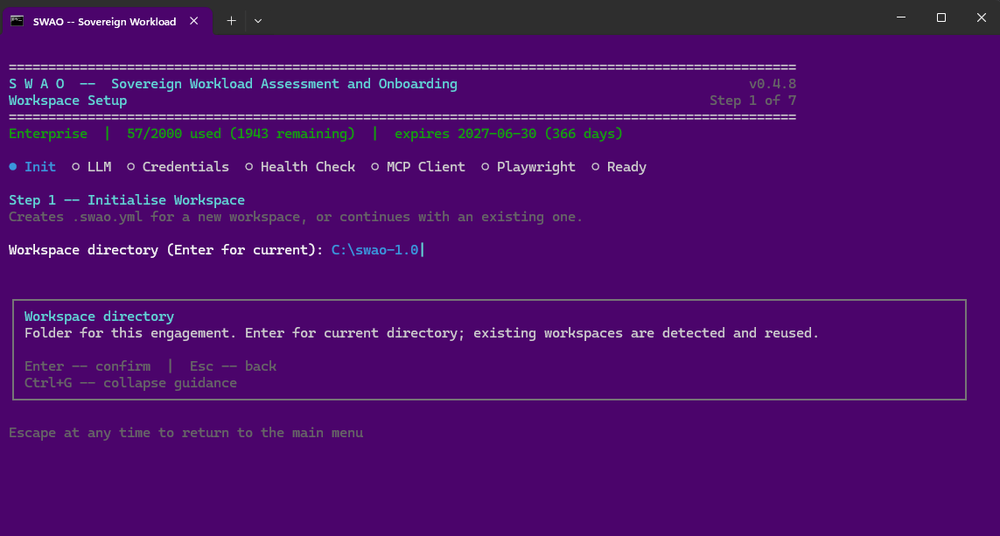

# 1. Workspace Setup

<iframe
  width="100%"
  style="aspect-ratio: 16/9; border: none; border-radius: 8px;"
  src="https://www.youtube.com/embed/J-4LXaI3mqU"
  allow="accelerometer; autoplay; clipboard-write; encrypted-media; gyroscope; picture-in-picture"
  allowfullscreen>
</iframe>

The **Workspace Setup** wizard runs when you select option 1 from the SWAO main menu. It has two parts: a generic workspace setup that every workspace needs, and one short setup per assessment type. You set up only the assessment types you will run, now or later.

## First run

1. **Workspace setup** (every workspace).
2. **Which assessments will you run?** Tick one or more of the five assessment types.
3. **One setup per chosen type**, in the order below. Each ends with a health check that covers only that type, then its own Ready summary.

The step bar shows the steps of the part you are in. During the setup of an assessment type, the finished workspace part is shown as one **Workspace** entry, and the subtitle names the type, for example *Setup: Landing Zone Live Assessment*.

## Workspace setup

| Step | What it does |
|---|---|
| Init | Engagement name, client code, owner and directory; creates the engagement folder structure and seeds four demo frameworks |
| LLM | Primary and optional secondary LLM provider and model: Anthropic, OpenAI, Amazon Bedrock Gateway, Ollama and the other gateway connectors |
| Credentials | Stores the LLM keys in the credential vault and checks the connection |
| MCP Client | Registers SWAO with Claude Desktop, Claude Code, Kilo, Cursor or VS Code (Enterprise) |
| Health Check | Runs the generic probes: licence, engagement metadata, credential vault, LLM gateway, MCP and community frameworks |
| Assessments | Choose the assessment types; saved as `workspace.assessment_types` in the workspace `.swao.yml` |

Assessment types your licence tier cannot run are shown greyed out with the tier they need. The Landing Zone Live Assessment needs Consultant; the other four run on every tier.

## Setup per assessment type

| Assessment type | Steps | Health check covers |
|---|---|---|
| Application Assessment | App, source access, Playwright browser, test code, scanners and IaC tools | prerequisites, IaC toolchain, Playwright, VCS access, imports, ingestion, scope, traceability, BI export |
| Service Portfolio Assessment | Service workspace, intake workbooks in the portfolio ingestion folder, scoring inputs | service workspace, intake mapping, APM weights, vendor catalogue, research cache, clustering, PII scrub audit, delta snapshot, framework controls |
| Landing Zone Catalog Assessment | Catalogues per provider (bundled, workspace and user-defined), targets, catalogue refresh | LZ catalogue coverage, community frameworks |
| Landing Zone Live Assessment | Landing zones and scopes with credentials, read-only probe, Client LZ Policy Baseline, organisational evidence | LZ connections, credential vault, community frameworks |
| LLM Assessment | Two to five candidate LLM connectors, the assessed app (needs a finished Application Assessment) | LLM gateway |

Every health check also runs the generic probes. A probe that does not serve the type is not run and not listed. The Ready summary shows the result (`ready` or `needs attention`), the failed and warned probes, and what is set up or missing. The state of each type is saved as `workspace.setup_state` in the workspace `.swao.yml`, so the Setup menu can show it.

## Later: set up another type

Open Setup again from the main menu. A workspace that was set up before offers:

- **Set up an assessment type**: the five types with their state (`not set up`, `ready`, `needs attention`); choosing one runs only its setup;
- **Workspace setup**: the generic part again;
- **Full setup**: the generic part, then the choice of types.

Every step shows its current value; Enter keeps it. A setup can be run again at any time.

Existing workspaces: on the first start after the update, SWAO records the types a workspace already uses (apps with runs, a `service_portfolio` block, `assessment.landing_zone.targets`, `landing_zones`, LLM Assessment runs) in `workspace.assessment_types`. Nothing else changes.

## Setup values are the assessment defaults

What a setup stores is preselected when you run that assessment. You can change it at run time; the change is not saved unless you save it as the new default.

| Assessment type | Stored in `.swao.yml` | Preselected in |
|---|---|---|
| Application | `apps/<id>/.swao.yml`, `assessment.test_code.mode` | the app picker (a single app is chosen automatically) |
| Service Portfolio | `service_portfolio.intake`, `service_portfolio.mapping` | the intake picker |
| Landing Zone Catalog | `assessment.landing_zone.targets` | the target list |
| Landing Zone Live | `landing_zones[]`, `landing_zones[].frameworks` | the landing zone, scope and framework pickers |
| LLM | `assessment.llm.candidates`, `assessment.llm.subject_app` | the candidate list and the app picker |

Older fields are still read: `service_portfolio.source` for the intake, and `llm_assessment.legs` and `llm_assessment.default_app` for the LLM candidates and the assessed app.


*The Workspace Setup wizard at step 1 (Init). Captured with an earlier SWAO version.*

## CLI equivalent

```bash
# Generic workspace setup
swao init my-engagement --name app-crm-01
swao credential set anthropic-api-key <your-api-key>

# Open the setup of one assessment type in the wizard
swao setup --type application

# Check one assessment type without the wizard (scripts, CI)
swao setup --type lz-live --non-interactive
swao setup --type service --non-interactive --json

# Health check of one assessment type
swao health-check --type llm
```

`--type` takes `application`, `service`, `lz-catalog`, `lz-live` or `llm` (`swao health-check` also takes `generic`). `swao setup --type <type> --non-interactive` runs the health check of that type, saves its state, prints the failed and warned probes and the missing items, and exits 1 when the type needs attention. Without `--type`, `swao health-check` runs all probes as before.

Landing zone catalogue targets can also be passed per run:

```bash
swao assess --app app-crm-01 --lz-cat-targets azure:europe,stackit:eu01
```

An app `.swao.yml` and `--lz-cat-targets` override the workspace targets. A geography resolves to its default region at run time; the application run records requested, resolved and skipped targets in `run-status.json`, and a skipped target marks the run as `partial`. The text report (`swao report`) lists them under **Landing Zone Catalogue Fit**.

New workspaces contain four demo frameworks. Further community frameworks are copied into the workspace from
[GitHub](https://github.com/Accenture/SWAO/tree/main/community-frameworks) (`wsp/inputs/catalogs/community/<folder>/`) and chosen per app when you run an assessment.

## Test code

By default SWAO analyses test code like production code. Mixed code bases can keep test code out of the findings:

```yaml
assessment:
  exclude_test_code: true      # short form; false (default) analyses everything
  # or the extended form:
  test_code:
    mode: tag                  # include (default) | tag | exclude
    extra_patterns: ["systemtest/**", "**/e2e/**"]
    keep_patterns: []
```

- `include`: everything is analysed; results are unchanged.
- `tag`: everything is analysed; findings that rest only on test code are marked `test_code` and lowered one severity step (the original severity is kept).
- `exclude`: test files are not read. The secret scan still covers them: a password in test code stays a finding, marked as test code.

Test code is recognised by built-in rules (`src/test/`, `test/`, `tests/`, `__tests__/`, `systemtest/`, `e2e/`, `mock/`, `*.test.ts`, `*.spec.js`, `*Test.java`, `*IT.java`, `*ITest.java`, ...) and by the test folders declared in `pom.xml`, Gradle source sets and vitest / jest configuration. `keep_patterns` wins over every rule. An app `.swao.yml` overrides the workspace setting. The publication's **Assessment Scope** shows the mode, the test-file count and the marked findings.

## After setup

Run a [Health Check](/health-check) at any time; `swao health-check --type <type>` checks one assessment type.

See also: [How it works](/how-it-works#the-assessment-pipeline)
