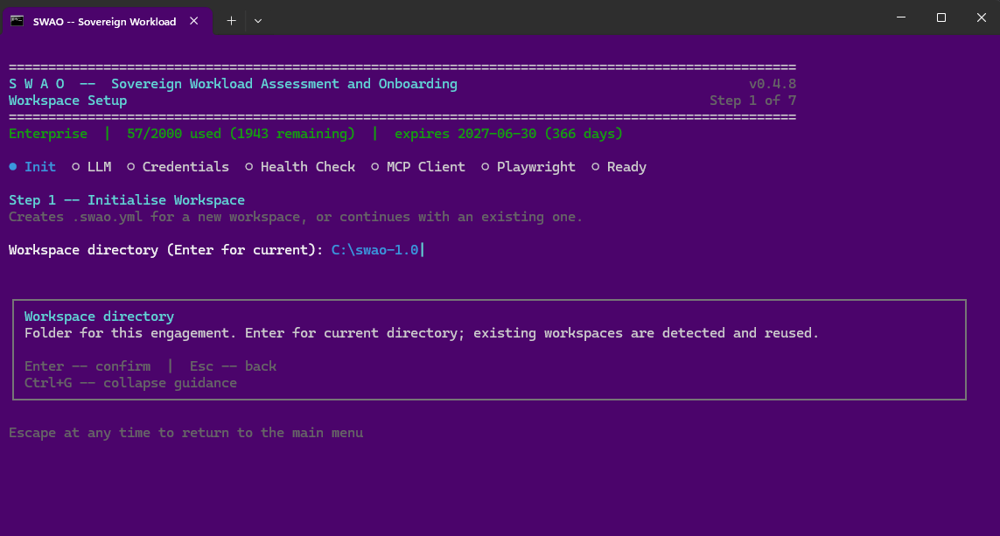

# 1. Workspace Setup

<iframe
  width="100%"
  style="aspect-ratio: 16/9; border: none; border-radius: 8px;"
  src="https://www.youtube.com/embed/J-4LXaI3mqU"
  allow="accelerometer; autoplay; clipboard-write; encrypted-media; gyroscope; picture-in-picture"
  allowfullscreen>
</iframe>

The **Workspace Setup** wizard runs when you select option 1 from the SWAO main menu. It initialises your engagement folder and writes a `.swao.yml` configuration file in one guided flow.

## What the wizard configures

| Step | What it does |
|---|---|
| Workspace | Engagement name, client code, owner, and directory; creates the engagement folder structure |
| LLM provider | Configures the AI provider: Anthropic, OpenAI, Amazon Bedrock Gateway, Ollama |
| Credentials | Stores API keys and vault references via `swao credential set` |
| LZ targets | Optional: pick landing zone catalogue providers, then per provider one or more geographies (for example `europe`, shown with its default region) or region ids. Writes `assessment.landing_zone.targets` to the workspace `.swao.yml`; every application run then fits these targets. Press `S` to skip |
| Health check | Runs the pre-flight probes once |
| Claude Desktop, Playwright | Optional integrations: MCP server configuration and the browser for dynamic analysis |
| Test code | How assessments treat test code: analyse all code (default), analyse all code and mark test-code findings, or exclude test code. Writes `assessment.test_code.mode` to the workspace `.swao.yml`. Press `Esc` to keep the current setting |

New workspaces contain four demo frameworks. Further community frameworks are copied into the workspace with
`swao framework install <ID>` and chosen per app when you run an assessment.


*The Workspace Setup wizard at step 1 (Init). The progress dots show the remaining steps. Captured with an earlier SWAO version; the current wizard also offers the LZ targets step.*

## CLI equivalent

```bash
swao init my-engagement --name app-crm-01
swao credential set anthropic-api-key <your-api-key>
swao framework install GDPR
swao regime-select --app app-crm-01 --regimes GDPR
# LZ targets: pass them per run, or set assessment.landing_zone.targets in .swao.yml
swao assess --app app-crm-01 --lz-cat-targets azure:europe,stackit:eu01
```

An app `.swao.yml` and `--lz-cat-targets` override the workspace targets. A geography resolves to its default region at run time; the application run records requested, resolved and skipped targets in `run-status.json`, and a skipped target marks the run as `partial`. The text report (`swao report`) lists them under **Landing Zone Catalogue Fit**.

## Test code

By default SWAO analyses test code like production code. Mixed code bases can keep test code out of the findings:

```yaml
assessment:
  exclude_test_code: true      # short form; false (default) analyses everything
  # or the extended form:
  test_code:
    mode: tag                  # include (default) | tag | exclude
    extra_patterns: ["systemtest/**", "**/e2e/**"]
    keep_patterns: []
```

- `include`: everything is analysed; results are unchanged.
- `tag`: everything is analysed; findings that rest only on test code are marked `test_code` and lowered one severity step (the original severity is kept).
- `exclude`: test files are not read. The secret scan still covers them: a password in test code stays a finding, marked as test code.

Test code is recognised by built-in rules (`src/test/`, `test/`, `tests/`, `__tests__/`, `systemtest/`, `e2e/`, `mock/`, `*.test.ts`, `*.spec.js`, `*Test.java`, `*IT.java`, `*ITest.java`, ...) and by the test folders declared in `pom.xml`, Gradle source sets and vitest / jest configuration. `keep_patterns` wins over every rule. An app `.swao.yml` overrides the workspace setting. The publication's **Assessment Scope** shows the mode, the test-file count and the marked findings.

## After setup

Run a [Health Check](/health-check) to verify that all pre-flight probes pass before starting an assessment.

See also: [How it works](/how-it-works#the-assessment-pipeline)
